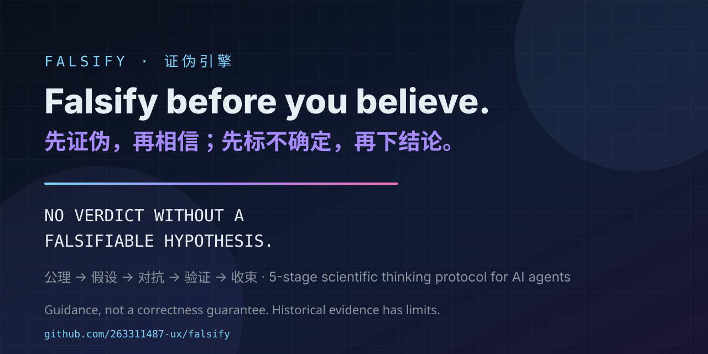
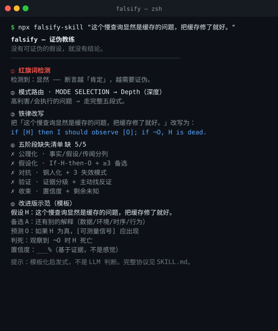

<div align="center">
  
</div>

<h1 align="center">falsify</h1>

<p align="center">
  <em>The scientific thinking protocol for AI agents. Falsify before you believe.</em><br>
  <em>像一流科学家一样思考：先证伪，再相信；先标不确定，再下结论。</em>
</p>

<p align="center">
  <a href="https://img.shields.io/github/stars/263311487-ux/falsify"></a>
  
  
  
  
  <a href="https://skills.sh/263311487-ux/falsify"></a>
</p>

<p align="center">
  <a href="README.zh-CN.md">简体中文</a> ·
  <a href="evals/cases.md">Evals</a> ·
  <a href="CHANGELOG.md">Changelog</a>
</p>

---

**falsify** is a single-Markdown skill that installs a 5-stage scientific thinking protocol on any AI agent (Codex, Claude Code, DeepSeek Harness, Cursor, Gemini CLI, …). It asks the agent to challenge confident claims; a prompt protocol does not guarantee correct reasoning.

**The Iron Law:**

```
NO VERDICT WITHOUT A FALSIFIABLE HYPOTHESIS.
没有可证伪的假设，就没有结论。
```

<p align="center">⭐ <strong>If this saved you from one confident wrong answer, <a href="https://github.com/263311487-ux/falsify">star the repo</a></strong> — it tells other agents (and humans) this protocol is worth trusting.</p>

<p align="center">
  <a href="https://263311487-ux.github.io/falsify/"></a>
  
  
  
</p>

Version 0.8.9 was published on 2026-10-09. Try `npx falsify-skill@0.8.9 --json "Check this claim"` without a model key. The commands below also work from a source checkout. See [first success](docs/first-success.md).

## Try the coach first — no API key

Requires Node.js 16 or newer. This runs locally without a model call or installing agent skills:

```bash
node bin/falsify-skill.mjs "The cache is definitely the cause"
```

The output is a checklist, not a verdict or completed test. From a checkout: `node bin/falsify-skill.mjs "The cache is definitely the cause"`.

## Intended behavior (illustrative, not a paired experiment)

| | Before (typical agent) | After (falsify) |
|---|---|---|
| Architecture question | Confident pro/con list → "Redis is a great fit" | Axioms → assumptions flagged → "I am 40% sure, because we have no volume data; cheapest first step is measuring, not adding Redis" |
| Bug diagnosis | "Probably a memory leak" | Hypothesis → adversarial check (deploy window? coincidence?) → evidence → calibrated verdict + residual risk |
| Data claim | "Yes, X is 5x faster" | Demands benchmark definition → labels claim hearsay if unverifiable → refuses to state it as fact |
| "Is this the best approach?" | Answers "yes, it's best" | Rewrites "best" as unfalsifiable → answers "best for [criteria] under [constraints]" |

## Install

Copy/paste into your CLI prompt (works for any agent that supports skills):

```text
Install the falsify skill from https://github.com/263311487-ux/falsify, refer to the repo's AGENTS.md for instructions.
```

Or with the skills CLI:

```text
npx skills add 263311487-ux/falsify
```

Or explicitly from a source checkout (installs the `SKILL.md` into Codex and Claude Code skill dirs automatically):

```text
node bin/falsify-skill.mjs --install
```

```text
node bin/falsify-skill.mjs --help
```

The installer refuses existing skill directories and symlinked destination parents. Review and move an older copy aside first. For a manual install, also include references/ and templates/. Clone the repo and copy `SKILL.md` into your agent's skills directory
(`~/.codex/skills/falsify/`, `~/.claude/skills/falsify/`, `.cursor/skills/falsify/`, …).


## Try it now (no agent required)

The npm package is a **falsification coach**, not just an installer — paste any claim and it walks it through the protocol:

```bash
node bin/falsify-skill.mjs "这个慢查询显然是缓存的问题，把缓存修了就好。"
#       ① Red-flag words   → 显然 detected — exactly the words the protocol distrusts
#       ② Mode routing     → Depth (high-stakes, acted-on)
#       ③ Iron Law rewrite → state H + assumptions, predict O, specify a noise-aware rejection rule
#       ④ Five-stage gap   → 5/5 missing (axiomatize → hypothesize → adversarialize → verify → converge)
#       ⑤ Upgrade template → rivals, prediction, kill condition, evidence grade, confidence
```

Works in English too, and is scriptable:

```bash
node bin/falsify-skill.mjs "The API is definitely the fastest solution"
node bin/falsify-skill.mjs --json "肯定是内存泄漏"     # machine-readable heuristic hints for CI / scripts
echo "restart fixed it, no need to dig deeper" | node bin/falsify-skill.mjs
```

It's a heuristic template, not an LLM judge — it reminds you what the protocol demands. The full protocol installs into your agent:

<div align="center">
  
</div>


```text
node bin/falsify-skill.mjs --install
```

## Why it is grounded (not vibes)

falsify is distilled from 70+ community sources and backed by academic work on
how agents should reason:

- **ICML 2026** — *Agentic AI systems should be making Bayes-consistent decisions*: agent confidence should update like a Bayesian, not a salesman.
- **Google** — *Teaching LLMs to reason like Bayesians*: calibration is learnable; agents can be trained out of overconfidence.
- **arXiv 2507.15015 (MetaCrit)** — multi-agent critique (generate / monitor / control / meta-synthesize) is the academic skeleton of our Stage 5 multi-perspective review.
- **UDora (ICML 2025)** — the strongest attack on a model's reasoning comes from its own inference trace; Stage 3 red-teams the reasoning chain itself.
- **CSA Agentic AI Red Teaming Guide** — systematic red teaming as a discipline, not a vibe.
- **arXiv 2606.19559** — separating *action-confidence* from *request-uncertainty* is how honest agents report what they do not know.
- **CIA ACH (Heuer, *Psychology of Intelligence Analysis*)** — competitive hypothesis analysis: 3–7 mutually exclusive candidates (including one you don't believe), diagnostic evidence (count the I's, not the C's), sensitivity analysis. The professional standard for structured analytic judgment.
- **Lakatos, *The Methodology of Scientific Research Programmes*** — the protective-belt check: patching a failing hypothesis with auxiliary assumptions is a degenerating programme, not a rescue.
- **Mayo, *Error and the Growth of Experimental Knowledge*** — a test only counts if it would have caught a wrong hypothesis (low P(E|¬H)).
- **Toulmin, *The Uses of Argument* / van Gelder, argument mapping** — draw the argument tree explicitly (contention → reasons → co-premises → warrant) before attacking it; the hidden co-premises are where arguments are weakest, and a flawless structure still does not make the premises true.
- **Pearl, do-calculus / *The Book of Why*** — the causal ladder (association → intervention → counterfactual); the backdoor criterion (did you miss a confounder?) and the collider trap (conditioning on a collider creates the bias you are seeing).
- **Reflexion (Shinn et al., NeurIPS 2023) / Huang et al. 2023 (*LLMs Cannot Self-Correct Reasoning Yet*)** — internal self-reflection is not verification: without an external signal, reflection drifts. Confidence only earns an upgrade when a test, a lookup, or an independent source changes it.
- **Kahneman, *Thinking, Fast and Slow* / Simon, bounded rationality** — dual-process routing: low-stakes reversible questions answer fast (System 1), high-stakes or irreversible ones get the full protocol (System 2); unbounded searches satisfice against a pre-declared aspiration threshold.
- **Galef, *The Scout Mindset* / von Neumann-Morgenstern utility** — the reversal test (would you accept the same evidence reversed?) and the bias audit catch motivated reasoning; expected-value rules (max EV / EU / minimax regret / satisficing) turn a calibrated verdict into a rational choice.
- **Snowden, Cynefin framework / Kepner-Tregoe analysis / Boyd, OODA loop** — classify the cause–effect domain before choosing a method (wrong-domain method is the failure mode); bound selective defects with IS/IS-NOT; screen decisions with MUST/WANT plus adverse-consequence tests; compare reversible mitigation costs with waiting, then re-observe when the situation is moving and the move is reversible.

## How it works

The five stages (`SKILL.md` is the full protocol):

```
公理化 Axiomatize   →  separate axioms / assumptions / hearsay
假设化 Hypothesize  →  H + assumptions → prediction + noise-aware rejection rule
对抗 Adversarialize →  steelman the opponent, attack yourself first
验证 Verify         →  hunt disconfirming evidence, grade it, run the cheapest test
收束 Converge       →  calibrated verdict, remaining unknowns, lesson to the ledger
```

- **Contextual by default.** Simple questions get simple answers — the protocol is a tool you reach for, not a costume you wear.
- **Orientation-aware.** Stage 0 detects a pre-sealed conclusion (conclusion-preserving, completion-seeking, authority-preserving) before reasoning starts.
- **Mental-model toolbox.** 20+ models mapped to the stage where they matter (pre-mortem, base rate, Chesterton's Fence, triangulation, Bayes…) — full catalog in `references/mental-models.md`.
- **Gentle nudge.** For acted-on answers that don't need full depth: 2–3 targeted questions, once per conversation, no nagging.
- **Red flags.** Eight rationalizing thoughts that mean STOP, mapped to reality.
- **Frontier questioning.** When input is needed, the whole open frontier is asked in one round — with recommended answers, never one-question-at-a-time interrogation.
- **Reasoning-type calibration.** Verdicts label their inference (deductive / inductive / abductive / analogical / counterfactual) and calibrate to its honest strength.
- **Visible thinking.** Depth mode renders a thinking ledger (`templates/thinking-ledger.md`) so reasoning is auditable.
- **Inspectable.** `evals/` ships 28 historical cases + rubric for examining adherence; no paired baseline is included.

## Evals

See [evals/cases.md](evals/cases.md) and [evals/rubric.md](evals/rubric.md). See [mode-aware rules and denominators](evals/README.md), including Stage-0 exceptions.

Author-run community case analysis is documented in [evals/dogfood-external-20260827.md](evals/dogfood-external-20260827.md): four selected GitHub/Stack Overflow cases, self-scored by the author; this was not independent validation and had no paired no-skill baseline.

**Historical incident note (2026-09)**: during [home-assistant/core#181420](https://github.com/home-assistant/core/issues/181420), the protocol kept local and server-side hypotheses open and pointed to one discriminating test. The vendor ([Genie](https://github.com/home-assistant/core/issues/181420#issuecomment-5564897751)) later reported rolling back a suspected server-side change; this supports investigating that side but does not establish the complete cause or exclude every local cause. Full write-up: [evals/dogfood-cli-20260907.md](evals/dogfood-cli-20260907.md).

**Historical cross-model result (associated with v0.8.3; report headers 2026-08-26, filenames 2026-08-27; exact run date unresolved):** the full 28-case suite was run on two external DeepSeek models in both directions. These are dated observations, not a proof or correctness guarantee:

- `deepseek-reasoner` generator × `deepseek-chat` judge → **26/28 report-level passes, avg 15.3/18**
- `deepseek-chat` generator × `deepseek-reasoner` judge → **26/28 report-level passes, avg 16.4/18**

The 12/18 threshold applies to scored depth-mode cases; routing/simple/question/nudge cases use different scoring rules. Historical reports record case 24 as PASS at 4/18 under Stage-0 routing, so 26/28 must not be read as 26 depth scores above 12.

The reports include failures and qualitative manual re-checks. A manual retry does **not** establish that an original failure was sampling variance, nor does it establish that the protocol has no stable gap. Paired baselines, pre-registered multiple seeds, held-out cases, and raw reproducible responses are future requirements, not present evidence. Reproduce only with the required external key: `DEEPSEEK_API_KEY=... node evals/run_evals.mjs --model deepseek-reasoner`. Provenance: [evals/provenance.json](evals/provenance.json) · failure cases and limits: [docs/failure-cases.md](docs/failure-cases.md) · reports: [reasoner](evals/results/deepseek-reasoner-2026-08-27.md) · [chat](evals/results/deepseek-chat-2026-08-27-final.md).

The skill is guidance and a prompt protocol, not a guarantee of correct reasoning. The bundled CLI is a deterministic heuristic coach, not an LLM judge.

> **Deployment note (reasoner-class models):** `reasoning_content` and `content` share the `max_tokens` budget; on very deep debugging questions the reasoner can spend the entire budget on reasoning and return **empty content** (observed at 6k–16k tokens). Set a generous `max_tokens`, add a retry-on-empty policy, or prefer `deepseek-chat` for latency-constrained deployments.

## Why "falsify"

The best coding agents are already excellent at producing answers. They are less good at *not believing their own answers*. falsify borrows the only epistemology that has a 400-year track record of not lying to itself — the scientific method — and turns it into five stages an agent can actually run.

Built on a simple inheritance: 公理 → 假设 → 对抗 → 验证 → 收束. Axiom → Hypothesis → Adversarialize → Verify → Converge.


## Sibling projects

falsify is one leg of a three-part workflow: **think** → **verify** → **present**.

- [**dsh-verify**](https://github.com/263311487-ux/dsh-verify) — browser-verified delivery. falsify keeps the thinking honest; dsh-verify keeps the *browser* honest (real-browser tests, not LLM-judged vibes). Use both: falsify catches the wrong conclusion, dsh-verify catches the broken output.
- [**imprint-pdf**](https://github.com/263311487-ux/imprint-pdf) — Markdown→PDF with a heuristic 0–100 report (`npx imprint-pdf`; Python package `imprint-pdf`).

Install any of them in one command:
```bash
npx skills add 263311487-ux/falsify
npx dsh-verify
npx imprint-pdf
```

## License


MIT. See [LICENSE](LICENSE).
